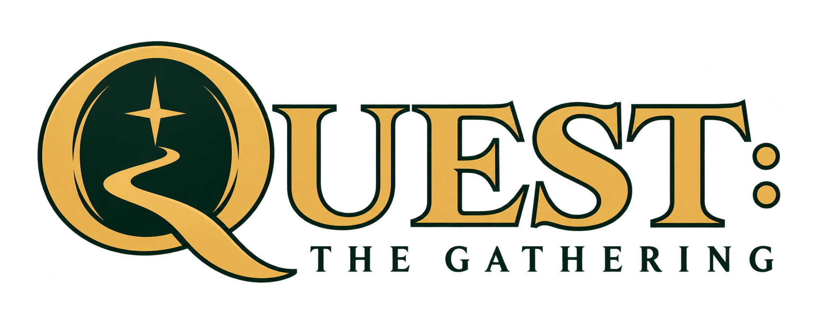

# ⚔️  Forge: The Magic: The Gathering Rules Engine

  

## Adventure development fork

This fork develops a single-player Adventure game using Forge's shared foundation:
dependable saves and quest progression, a coherent campaign, rewarding
exploration, and tools for building more Adventure content. Multiplayer and
standalone Duel modes are outside the fork's product scope. Adventure's own card
battles continue to use the shared rules engine, computer opponent, and card data.

Core requirements are campaign selection on every New Game and multiple
independent playthroughs, with separate manual saves, autosaves, and quicksaves
for each run. Campaign packages can provide distinct worlds and stories. See
[Campaigns and saves](docs/Adventure/Campaigns-and-Saves.md) for the requirements,
current limitations, and proposed implementation; these features are not yet
implemented by the progression patch.

The inherited Adventure campaign and systems will be assessed for reuse. Its
story, setting, quests, maps, progression, and interface may be retained, reworked,
or replaced completely to serve the experience we want to build. The next design
milestone is an assessment and a playable example of the chosen direction;
existing locations and campaign structure are optional.

Development follows this fork's Adventure goals. Submitting changes upstream is
not planned; useful upstream fixes can be selectively imported when they benefit
Adventure. The planned application flow will center on starting or continuing an
Adventure, managing saves, and adjusting settings.

See the [Adventure roadmap](docs/Adventure/Fork-Roadmap.md) for priorities and the
[progression validation guide](docs/Adventure/Progression-Validation.md) for the
checks required before releasing progression changes.

## Upstream project reference

The following sections retain upstream project information for reference,
including modes outside this fork's development scope. Upstream download links
provide upstream builds; use this fork's source to build its Adventure changes.

Join the **Forge community** on [Discord](https://discord.gg/HcPJNyD66a)!

---

## ✨ Introduction
**Forge** is a dynamic and open-source **Rules Engine** tailored for **Magic: The Gathering** enthusiasts. Developed by a community of passionate programmers, Forge allows players to explore the rich universe of MTG through a flexible, engaging platform. 

**Note:** Forge operates independently and is not affiliated with Wizards of the Coast.

---

## 🌟 Key Features
- **🌐 Cross-Platform Support:** Play on **Windows, Mac, Linux,** and **Android**.
- **🔧 Extensible Architecture:** Built in **Java**, Forge encourages developers to contribute by adding features and cards.
- **🎮 Versatile Gameplay:** Dive into single-player modes or challenge opponents online!

---

## 🛠️ Installation Steps

### 📥 Desktop
1. **Latest Releases:** Download the latest version [here](https://github.com/Card-Forge/forge/releases/latest).
2. **Snapshot Build:** For the latest development version, grab the `forge-gui-desktop` tarball from our [Snapshot Build](https://github.com/Card-Forge/forge/releases/tag/daily-snapshots).
   - **Tip:** Extract to a new folder to prevent version conflicts.
3. **User Data Management:** Previous players’ data is preserved during upgrades.
4. **Java Requirement:** Ensure you have **Java 17 or later** installed.

### 📱 Android
- _(Note: **Android 11** is the minimum requirement with at least **6GB RAM** to run smoothly. You need to enable **"Install unknown apps"** for Forge to initialize and update itself)_
- Download the **APK** from the [Snapshot Build](https://github.com/Card-Forge/forge/releases/tag/daily-snapshots). On the first launch, Forge will automatically download all necessary assets.

### 📱 iOS (early stage)
- Build the **IPA** according to Wiki
- No jailbreak needed, only developer mode and iOS 16-27
- Connect your device to a PC to self-sign and upload the app file, multiple tools exist e.g. [Sideloadly](https://sideloadly.io)

---

## 🎮 Modes of Play
Forge offers various exciting gameplay options:

### 🌍 Adventure Mode
Embark on a thrilling single-player journey where you can:
- Explore an overworld map.
- Challenge diverse AI opponents.
- Collect cards and items to boost your abilities.

### 🔍 Quest Mode
Engage in focused gameplay without the overworld exploration—perfect for quick sessions!

### 🤖 AI Formats
Test your skills against AI in multiple formats:
- **Sealed**
- **Draft**
- **Commander**
- **Cube**

For comprehensive gameplay instructions, visit our [User Guide](https://github.com/Card-Forge/forge/wiki/User-Guide).

---

## 💬 Support & Community
Need help? Join our vibrant Discord community! 
- 📜 Read the **#rules** and explore the **FAQ**.
- ❓ Ask your questions in the **#help** channel for assistance.

---

## 🤝 Contributing to Forge
We love community contributions! Interested in helping? Check out our [Contributing Guidelines](CONTRIBUTING.md) for details on how to get started.

---

## ℹ️ About Forge
Forge aims to deliver an immersive and customizable Magic: The Gathering experience for fans around the world. 

### 📊 Repository Statistics

| Metric         | Count                                                       |
|----------------|-------------------------------------------------------------|
| **⭐ Stars:**   |  |
| **🍴 Forks:**   |  |
| **👥 Contributors:** |  |

---

**📄 License:** [GPL-3.0](LICENSE)

    

        
    

